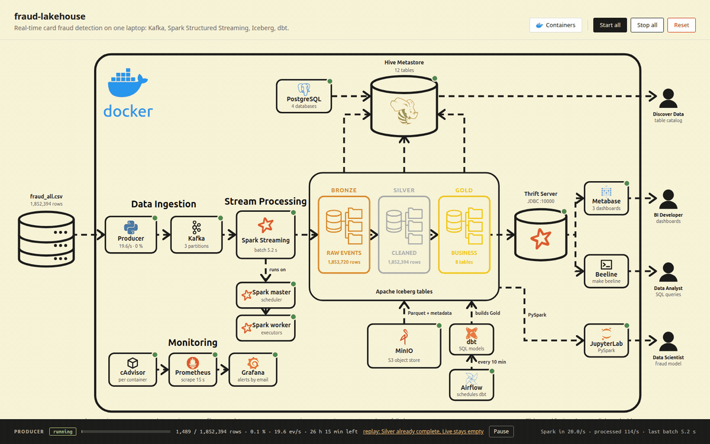
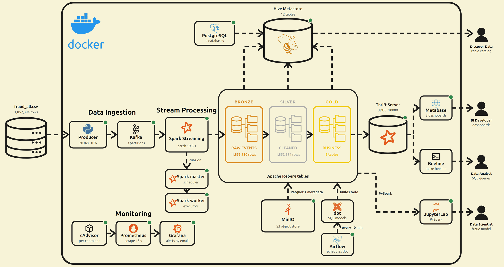
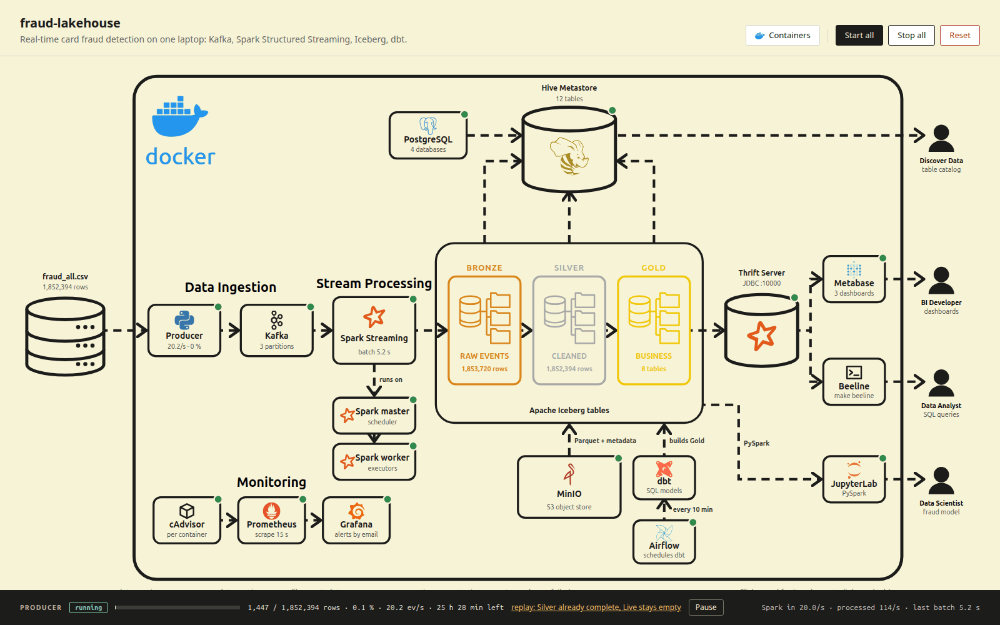
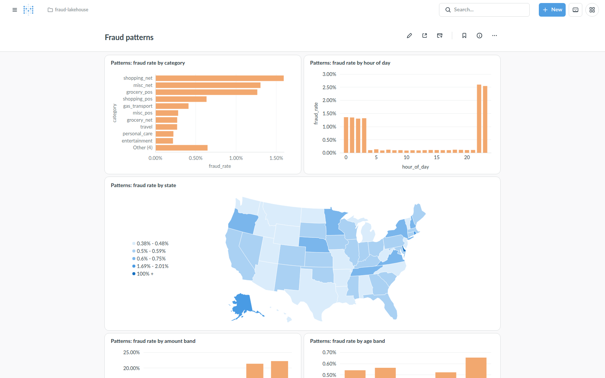
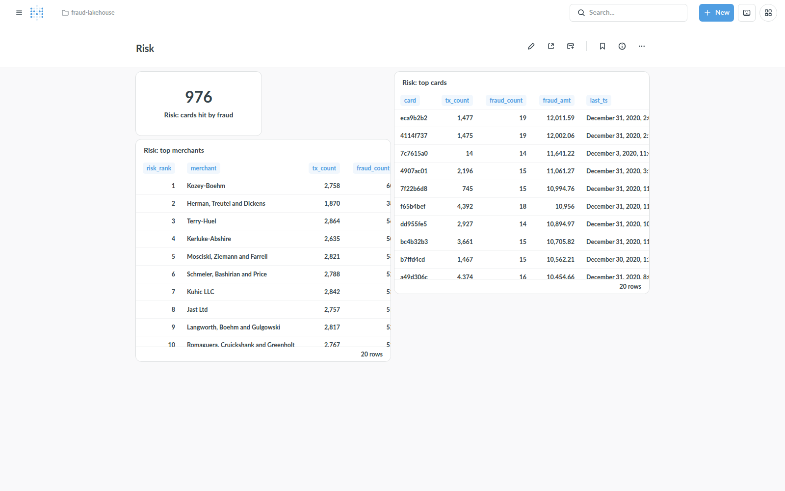
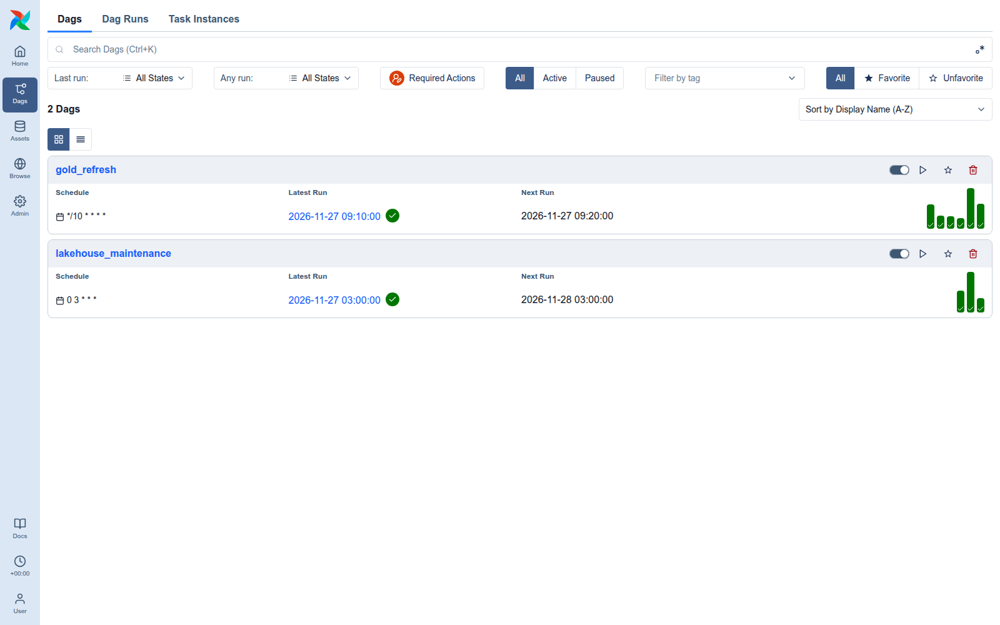

# fraud-lakehouse

[](https://github.com/Anaximandr0s/fraud-lakehouse/actions/workflows/ci.yml)
[](https://github.com/Anaximandr0s/fraud-lakehouse/releases)
[](#testing)


[](LICENSE)

A real-time card fraud detection lakehouse that runs end to end on one laptop with Docker Compose.

Card transactions stream from Kafka through Spark Structured Streaming into Apache Iceberg tables (Bronze, Silver,
Gold) on S3-compatible storage. dbt builds the Gold layer every 10 minutes under Airflow. Metabase dashboards, a SQL
endpoint and a fraud model notebook read the tables, while Prometheus and Grafana watch every container. 15
long-running services, all open source and pinned, started with one command and run from a control center.



## Highlights

- **No loss, no duplicates.** Spark checkpoints its Kafka offsets and Silver is written with `MERGE` on
  `trans_num`. `make recovery-check` stops the whole stack, starts it again and proves that no Silver row is lost,
  no Kafka offset is skipped and no duplicate appears.
- **Medallion layers on Iceberg.** Bronze keeps every message as received. Silver holds typed, validated,
  deduplicated rows, and a rejected table records why each invalid row was refused. Gold holds dbt models with data
  tests.
- **Fraud model.** Gradient-boosted trees reach a PR-AUC of 0.88 on a time-based test split, against 0.004 for a
  random model. See [Results](#results).
- **Operations.** Healthchecks, restart policies and measured memory limits on every service, nightly Iceberg
  compaction, six email alerts.
- **Control center.** A local page that draws the pipeline with live state and starts, stops and pauses services
  without a terminal.

## Architecture



| Stage | Tools | Role |
|---|---|---|
| Ingest | Python producer, Apache Kafka 4.3 (KRaft) | Replays the dataset as live events, keyed by card |
| Process | Spark 3.5 Structured Streaming | Kafka → Bronze → Silver every 30 s |
| Process | dbt-spark 1.11, Airflow 3.3 | Gold models every 10 min, nightly table maintenance |
| Store | Apache Iceberg 1.12, MinIO, Hive Metastore 3.1.3, PostgreSQL 18 | Table format, object storage, catalog |
| Serve | Spark Thrift Server, Metabase 0.64, Beeline, JupyterLab | SQL over JDBC, dashboards, notebooks |
| Observe | Prometheus 3.15, Grafana 13.3, cAdvisor | Metrics, dashboard, email alerts |

The full design is in [docs/architecture.md](docs/architecture.md): tables and their columns, validation rules,
DAGs, alerts, ports, the memory budget and the reasons behind each choice.

## Dataset

[Credit Card Transactions Fraud Detection](https://www.kaggle.com/datasets/kartik2112/fraud-detection) on Kaggle,
generated with the [Sparkov](https://github.com/namebrandon/Sparkov_Data_Generation) simulator: 999 cards paying
693 merchants in 14 categories across the 50 US states and DC.

| | Train file | Test file | Merged (`data/fraud_all.csv`) |
|---|---|---|---|
| Period | 2019-01-01 → 2020-06-21 | 2020-06-21 → 2020-12-31 | 2019-01-01 → 2020-12-31 |
| Transactions | 1,296,675 | 555,719 | 1,852,394 |
| Frauds | 7,506 (0.58 %) | 2,145 (0.39 %) | 9,651 (0.52 %) |

Each row is one card payment: time, card number, merchant and category, amount, cardholder (name, gender, address,
city population, job, date of birth), merchant coordinates, and the `is_fraud` label.

How the project uses it:

- `make data` downloads the zip (no Kaggle account needed), sorts the train file by time (1,858 rows are out of
  order), merges both files and checks the result: 22 columns, time order, unique `trans_num`, row count.
- The producer replays the merged file as live events. Silver drops the personal fields (name, street, date of
  birth), replaces the card number with a salted hash, and derives age, distance to the merchant, hour and day of
  week.
- The boundary between the two files becomes the model's train/test split, so the model is always evaluated on
  transactions that happened after the ones it learned from.
- Silver corrects the simulator's traces: every merchant name starts with `fraud_` (not a label), `zip` loses its
  leading zeros, and `unix_time` is shifted by 7 years.

## Quick start

You need Linux with Docker Compose 2.24+, [uv](https://docs.astral.sh/uv/), GNU Make, and about 14 GB of free RAM
for every service (built and measured on a 16 GB, 6-core laptop).

```bash
cp .env.example .env     # then replace every change-me value
make up-all              # downloads the jars and the dataset, builds the images, starts everything but JupyterLab
make control-center      # http://localhost:8099
```

Once the downloads and images are in place, `make up-all` takes about 7 minutes. From then on the control center
runs everything with buttons: stop, start, pause the producer, open each UI.

Every action is also a Make target:

```bash
make up-core             # the pipeline only: Kafka, Spark, Iceberg, producer
make up-orchestration    # + Airflow
make up-bi               # + Metabase
make metabase-setup      # create the Metabase admin and dashboards (safe to rerun)
make up-monitoring       # + Prometheus, Grafana, cAdvisor
make up-notebook         # + JupyterLab
make down                # stop everything; data stays in Docker volumes
```

The producer replays the CSV at `RATE` events per second: 20 by default, so the Live dashboard moves at a readable
pace. Set `RATE=500` in `.env` to replay all 1.85 M transactions in about an hour, which the fraud model needs.

## Control center



`make control-center` serves a page on http://localhost:8099, bound to 127.0.0.1, that shows the whole pipeline:

- **Live state.** Each card shows whether its service is running, starting, stopped or failed, with a live figure
  (rows in each table, batch duration, producer rate). Dashed arrows mark where data is moving now. The bottom bar
  shows the producer's position in the CSV, its rate, the time left, and Spark's input and processing rates.
- **Service panels.** Click a card for its role, ports, image, memory and links: the MinIO folder of each table, the
  Spark UIs, each Metabase dashboard, Grafana, Airflow, JupyterLab. The Hive Metastore panel lists every table with
  its row count, size and last write.
- **Actions.** **Start all**, **Stop all** and **Reset** (deletes every volume; you type `reset` to confirm). The
  producer, Airflow, Metabase, JupyterLab and the monitoring services can be stopped on their own, because
  ingestion never waits on them. **Containers** lists every container with its memory against its limit.

Stopping keeps the data. To resume, press **Start all**: the producer continues from its saved row and Spark from
its checkpoint.

## Dashboards

**Metabase** (http://localhost:3000) has three dashboards, created by code with `make metabase-setup`:

- **Live** reads Silver: transactions, frauds, fraud rate and amount over the last hour, a per-minute line and the
  latest frauds. It refreshes every minute while the producer runs.
- **Fraud patterns** reads Gold: fraud rate by category, hour of day, state, amount band and age band.
- **Risk** reads Gold: the riskiest merchants and cards.





**Grafana** (http://localhost:3001) shows the pipeline's health: Spark input against processed rows per second,
batch duration, producer progress, scrape targets, each container's memory against its limit, and MinIO free disk.
Six alerts send an email when streaming stops, falls behind or slows down, when a target is down, when a container
nears its memory limit, or when MinIO runs out of disk.

**Airflow** (http://localhost:8082) runs `gold_refresh` every 10 minutes (dbt freshness, run, test) and
`lakehouse_maintenance` every night (Iceberg compaction, snapshot expiry, orphan file cleanup).



## Results

`notebooks/fraud_model.ipynb` trains on the cluster with Spark MLlib (seed 42):

- the models learn from the train file's period (1,296,675 transactions);
- each decision threshold is the best F1 on the latest 20 % of that period;
- the numbers below come from the test file's period (555,719 transactions, 0.386 % fraud), never used for
  training or tuning. A random model's PR-AUC equals that fraud rate.

| Model | Threshold | PR-AUC | Precision | Recall |
|---|---|---|---|---|
| Random | – | 0.0039 | 0.0039 | – |
| Logistic regression | 0.94 | 0.1872 | 0.2669 | 0.5604 |
| Gradient-boosted trees | 0.95 | 0.8823 | 0.8147 | 0.8448 |

At its threshold, gradient-boosted trees catch 84 % of the frauds, and 81 % of the transactions they flag are
frauds. Their most important features are `log_amt` (0.494), `amt` (0.135) and `card_amt_ratio` (0.126): the
amount, and how unusual it is for that card over the last 24 hours.

## How it works

1. **Ingest.** `producer/` replays `data/fraud_all.csv` into Kafka, keyed by card. It saves its position once Kafka
   acknowledges, so a restart resumes where it stopped.
2. **Stream.** `spark/jobs/streaming.py` reads Kafka every 30 s. Each batch is appended to
   `bronze.transactions_raw`, then parsed, validated, cleaned and enriched by the pure functions in
   `src/fraud_lakehouse/silver.py`, and merged into `silver.transactions`. Invalid rows land in
   `silver.transactions_rejected` with their reason.
3. **Model.** Airflow runs dbt through the Thrift Server: fraud rates by category, hour, state, amount and age;
   merchant and customer risk; and `gold.ml_features`, whose card-level features only look at the past.
4. **Serve.** Metabase and Beeline query Silver and Gold over JDBC. JupyterLab trains the models on the Spark
   cluster.
5. **Watch.** Prometheus scrapes Spark, the producer, MinIO and cAdvisor; Grafana draws the dashboard and sends the
   alerts.

```
src/fraud_lakehouse/   shared package: config, schemas, Silver transforms, model, dashboards, control center
producer/              CSV → Kafka entrypoint
spark/                 Spark image, spark-defaults.conf, streaming job
dbt/                   staging and Gold models, data tests
airflow/               image and DAGs
monitoring/            Prometheus config, Grafana dashboard and alert rules
notebooks/             fraud model notebook
control-center/        control center page
scripts/               data preparation, Metabase setup, control center server, recovery check
tests/                 unit tests
docs/                  architecture and images
```

## Commands

The Makefile is the only entrypoint; `make help` lists every target.

| Command | What it does |
|---|---|
| `make up-all` / `make up-core` | Start every service but JupyterLab, or only the pipeline, and wait until healthy |
| `make down` | Stop every service, data kept |
| `make control-center` | Serve the control center |
| `make beeline` | SQL shell on the Thrift Server |
| `make psql db=metastore` | SQL shell on PostgreSQL (`metastore`, `airflow` or `metabase`) |
| `make silver-count` | Bronze and Silver row counts and Silver duplicates |
| `make dbt args="run"` | Run dbt from the host |
| `make ml-features` | Build `gold.ml_features` for the model |
| `make up-notebook` / `make notebook-run` | Start JupyterLab, or run the fraud notebook headless |
| `make metabase-check` / `make monitoring-check` | Run every dashboard card; list Prometheus targets |
| `make recovery-check` | Restart everything and prove no row is lost |
| `make reset-producer` | Replay the CSV from the start |
| `make logs s=kafka` | Follow one service's logs |

| UI | URL | Login |
|---|---|---|
| Control center | http://localhost:8099 | – |
| Metabase | http://localhost:3000 | `METABASE_ADMIN_EMAIL` / `METABASE_ADMIN_PASSWORD` |
| Airflow | http://localhost:8082 | `admin` / `make airflow-password` |
| Grafana | http://localhost:3001 | `admin` / `GRAFANA_ADMIN_PASSWORD` |
| MinIO console | http://localhost:9001 | `MINIO_ROOT_USER` / `MINIO_ROOT_PASSWORD` |
| JupyterLab | http://localhost:8888/lab | token `JUPYTER_TOKEN` |
| Prometheus | http://localhost:9090 | – |
| Spark master, streaming, Thrift UIs | http://localhost:8080, :4040, :4041 | – |

## Testing

| Check | Command | What it covers |
|---|---|---|
| Lint | `make lint` | ruff, lint and format |
| Unit tests | `make test` | 102 tests on a local SparkSession: producer replay and resume, Silver parsing and validation, model features and metrics, dashboards, control center commands |
| Coverage | `make test` | **98.7 %** branch coverage of `src/fraud_lakehouse`; the run fails under 95 % |
| Data tests | `make dbt args="test"` | `not_null` and `unique` on every Gold model |
| Recovery | `make recovery-check` | full stop and start: no lost row, no offset gap, no duplicate |

The unit tests need Java 17 for PySpark and nothing else: no Docker, no network.

CI ([`.github/workflows/ci.yml`](.github/workflows/ci.yml)) runs on every push and pull request: ruff, pytest with
coverage, `dbt parse`, `docker compose config`, promtool, hadolint on every Dockerfile, and actionlint. Pushing a
`vX.Y.Z` tag reruns CI and publishes a [GitHub release](https://github.com/Anaximandr0s/fraud-lakehouse/releases).

## Contributing

Issues and pull requests are welcome. [CONTRIBUTING.md](CONTRIBUTING.md) covers the setup, where code goes and how
changes are reviewed.

## License

[MIT](LICENSE). The control center's logos come from [Simple Icons](https://simpleicons.org) (CC0) and remain
trademarks of their owners.
