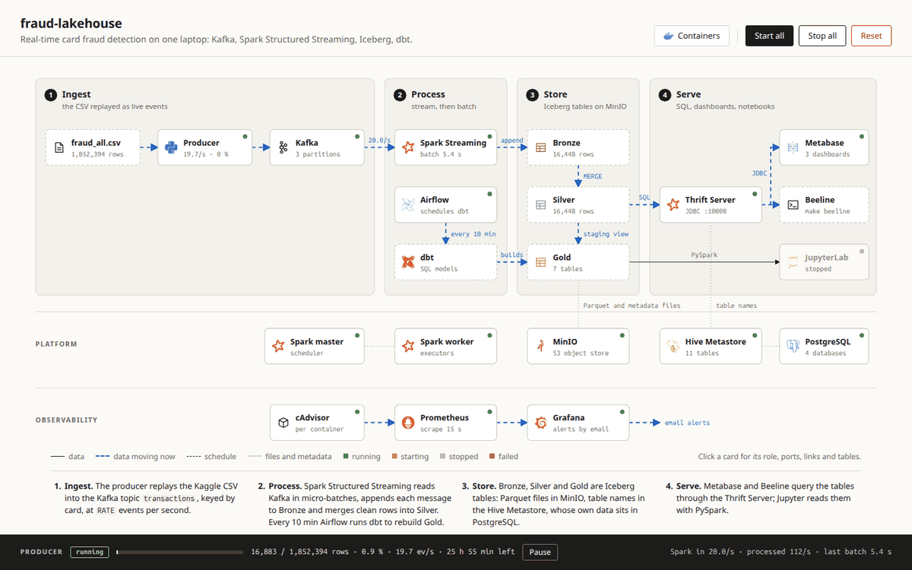

# fraud-lakehouse

[](https://github.com/Anaximandr0s/fraud-lakehouse/actions/workflows/ci.yml)
[](LICENSE)


A streaming lakehouse for card fraud detection that runs end to end on one laptop with Docker Compose.
Card transactions flow from Kafka through Spark Structured Streaming into Apache Iceberg tables
(Bronze, Silver, Gold) on S3-compatible storage. From there they feed live dashboards, SQL and a fraud model.
Every service is open source, pinned and started by one command.



## Highlights

- **Streaming ingestion without loss or duplicates.** Spark checkpoints its Kafka offsets, and Silver is
  written with `MERGE` on `trans_num`. `make recovery-check` stops every container, starts it again and proves it:
  - every Silver row of the earlier snapshot is still there;
  - the Kafka offsets read after the restart have no gap;
  - Silver has no duplicates.
- **Medallion layers on Iceberg.**
  - Bronze keeps every message as received.
  - Silver holds typed, cleaned, deduplicated rows. Invalid rows go to a rejected table.
  - Gold holds the dbt models built every 10 min.
- **Serving.** Metabase dashboards (Live, Fraud patterns, Risk) and Beeline through the Spark Thrift Server, and
  JupyterLab with PySpark for the fraud model.
- **Operations.**
  - Airflow schedules Gold and nightly table maintenance.
  - Prometheus, Grafana and cAdvisor track every container and send email alerts.
  - Every long-running service has a healthcheck, a restart policy and a measured memory limit.
- **Demo page.** A local control page draws the pipeline with live state and links. It starts, stops and pauses
  the stack without a terminal.
- **Fraud model.** Gradient-boosted trees reach a PR-AUC of 0.88 on a time-based test split (see [Results](#results)).

## Architecture


| Stage | Tool | Role |
|---|---|---|
| Ingest | Python producer, Apache Kafka 4.3 (KRaft) | Replays the CSV as events, topic `transactions`, 3 partitions |
| Process | Spark 3.5 Structured Streaming | Kafka → Bronze → Silver in one micro-batch |
| Process | dbt-spark 1.11, Airflow 3.3 | Gold models every 10 min, daily compaction |
| Store | Apache Iceberg 1.12, MinIO, Hive Metastore 3.1.3, PostgreSQL 18 | Table format, object storage, catalog |
| Serve | Spark Thrift Server, Metabase 0.64, Beeline, JupyterLab | SQL over JDBC, dashboards, notebooks |
| Observe | Prometheus 3.15, Grafana 13.3, cAdvisor | Metrics, dashboard, email alerts |

Every image and jar version is pinned in [`.env.example`](.env.example). The full design is in
[docs/architecture.md](docs/architecture.md): tables, schemas, ports, memory budget and build plan.

## Quick start

Requirements:
- Linux with Docker Compose 2.24+ (built and measured on Ubuntu, 16 GB RAM, 6 cores);
- [uv](https://docs.astral.sh/uv/) and GNU Make;
- about 14 GB of free RAM for every service.

```
cp .env.example .env   # then replace every change-me password
make up-all            # downloads jars and the dataset, builds the images, starts every service but Jupyter
make demo              # control page on http://localhost:8099
```

Once the jars, dataset and images are in place, `make up-all` takes about 7 minutes.

### Stopping and resuming

- **Stop all** on the page, or `make down`, removes every container and network. The services stop using RAM and
  CPU, and their ports are released. The data stays in Docker volumes.
- `make demo` itself keeps port 8099 until you press `Ctrl+C` in its terminal. That closes the page, not the
  services.
- To resume, run `make demo` (if it is not still running), open http://localhost:8099 and press **Start all**. The
  producer continues from its saved row and Spark from its checkpoint.

## Demo page

`make demo` serves http://localhost:8099 from a host process bound to 127.0.0.1. No container gets the Docker socket
.

- **Start all** runs `make up-all`, **Stop all** runs `make down`, and **Reset** deletes every volume (you must
  type `reset` to confirm). While an action runs, the page is locked and shows its output.
- Click a card to see its role, ports, image, memory and links:
  - MinIO folders, Spark UIs, Airflow, each Metabase dashboard, Grafana, Prometheus and JupyterLab;
  - Hive Metastore lists every table with its row count, size and last write;
  - PostgreSQL lists its databases;
  - Beeline and PostgreSQL show their terminal commands.
- The producer, Airflow, Metabase, JupyterLab, Prometheus, Grafana and cAdvisor can be stopped and started on their
  own: ingestion (Kafka to Silver) never waits on them. Core services cannot.
- **Containers** shows `docker compose ps` and `docker stats`.
- The bottom bar shows the producer's position in the CSV, its rate, the time left and Spark's rates.

The Live dashboard reads the last hour of Silver, so it fills only while new transactions arrive. Once Silver holds
the whole CSV, a replay adds nothing and the page says so. Before a presentation, press **Reset** then **Start all**
(about 7 min) to watch Live fill from the first minute.

## How it works

1. **Ingest.** `producer/` replays `data/fraud_all.csv` into Kafka at `RATE` events/s (default 20), keyed by card. It
   saves its position once Kafka acknowledges, so a restart resumes where it stopped.
2. **Stream.** `spark/jobs/streaming.py` reads Kafka in micro-batches. Each batch appends to
   `bronze.transactions_raw`, cleans and types the rows with the pure functions of `src/fraud_lakehouse/silver.py`,
   and merges them into `silver.transactions`.
3. **Model.** Every 10 min, the Airflow DAG `gold_refresh` runs dbt through the Thrift Server. dbt builds the Gold
   aggregates (by category, hour, state, amount, age band) and the merchant and customer risk tables. dbt tests
   check every model.
4. **Serve.** Metabase reads Silver and Gold over JDBC; its dashboards are created by code
  . Beeline gives a SQL shell, and JupyterLab trains the
   fraud model on `gold.ml_features`.
5. **Watch.** Prometheus scrapes Spark, the producer, MinIO and cAdvisor. Grafana shows the Pipeline dashboard and
   emails six alerts: target down, streaming behind or slow, no input, container memory, MinIO disk.

```
src/fraud_lakehouse/   shared package: config, schemas, pure transforms, demo catalog
producer/              CSV → Kafka entrypoint
spark/                 image, spark-defaults.conf, streaming job
dbt/                   staging and Gold models, tests in schema.yml
airflow/dags/          gold_refresh, lakehouse_maintenance
monitoring/            prometheus.yml, Grafana dashboards and alert rules
notebooks/             fraud model (Spark MLlib)
demo/                  demo page (HTML, CSS, JS, icons)
scripts/               data preparation, Metabase setup, demo server, recovery check
tests/                 unit tests, mirroring src/
docs/                  architecture.md, images
```

## Commands

The Makefile is the only entrypoint; `make help` lists every target.

| Command | What it does |
|---|---|
| `make up-core` / `make up-all` | Start the pipeline, or every service but Jupyter, and wait until healthy |
| `make down` | Stop every service, volumes kept |
| `make demo` | Serve the demo page |
| `make beeline` | SQL shell on the Thrift Server |
| `make psql db=metastore` | SQL shell on PostgreSQL (`metastore`, `airflow` or `metabase`) |
| `make silver-count` | Bronze and Silver row counts, Silver duplicates |
| `make dbt args="run"` | Run dbt from the host |
| `make up-notebook` / `make notebook-run` | Start JupyterLab, or run the fraud notebook headless |
| `make metabase-check` / `make monitoring-check` | Run every dashboard card, list Prometheus targets |
| `make recovery-check` | Restart everything and prove no row is lost |
| `make reset-producer` | Replay the CSV from the start |
| `make logs s=kafka` | Follow one service's logs |

## Web UIs

| UI | URL | Login |
|---|---|---|
| Demo page | http://localhost:8099 | – |
| Metabase | http://localhost:3000 | `METABASE_ADMIN_EMAIL` / `METABASE_ADMIN_PASSWORD` |
| Airflow | http://localhost:8082 | `admin` / `make airflow-password` |
| Grafana | http://localhost:3001 | `admin` / `GRAFANA_ADMIN_PASSWORD` |
| MinIO console | http://localhost:9001 | `MINIO_ROOT_USER` / `MINIO_ROOT_PASSWORD` |
| JupyterLab | http://localhost:8888/lab | token `JUPYTER_TOKEN` |
| Prometheus | http://localhost:9090 | – |
| Spark master, streaming, Thrift | http://localhost:8080, :4040, :4041 | – |

Logins come from `.env`. Kafka listens on `localhost:9094` for host clients, the Thrift Server on
`localhost:10000`. Every port is listed in [architecture.md §8](docs/architecture.md#8-ports).

## Testing

- `make lint test` runs ruff and the pytest unit tests. Silver transforms run on a local SparkSession and need
  Java 17+.
- `make dbt args="test"` runs the dbt data tests on Gold.
- `make recovery-check` restarts the stack and checks for data loss, offset gaps and duplicates.
- CI ([`.github/workflows/ci.yml`](.github/workflows/ci.yml)) runs on every push and pull request:
  - ruff and pytest;
  - `dbt parse`;
  - `docker compose config`;
  - hadolint on the Dockerfiles.

## Results

The fraud model is trained by `notebooks/fraud_model.ipynb` (Spark MLlib, seed 42):
- training uses the train split (the fraudTrain.csv period, 1,296,675 transactions);
- the decision threshold is the best F1 on the latest 20 % of the train split;
- metrics come from the test split (555,719 transactions, 0.386 % fraud), never used for fitting or tuning;
- a random model's PR-AUC equals the test fraud rate.

| Model | Threshold | PR-AUC | Precision | Recall |
|---|---|---|---|---|
| Random | – | 0.0039 | 0.0039 | – |
| LogisticRegression | 0.94 | 0.1872 | 0.2669 | 0.5604 |
| GBT | 0.95 | 0.8823 | 0.8147 | 0.8448 |

- GBT's 5 most important features: `log_amt` (0.494), `amt` (0.135), `card_amt_ratio` (0.126), category
  `gas_transport` (0.047), category `grocery_pos` (0.030).
- PR-AUC is Spark's trapezoid area under the full precision-recall curve (`numBins=0`), not scikit-learn's average
  precision.
- `make notebook-run` writes this table to `notebooks/out/results.md`, with the data snapshot it used.

## Troubleshooting

- **A password changed in `.env` has no effect.** Postgres sets role passwords only when its volume is created. Run
  `ALTER ROLE … PASSWORD …` in `make psql`, or **Reset** if no data needs keeping.
- **spark-streaming fails on restart after a long stop.** Kafka keeps events for 24 h, and the job fails
  (`failOnDataLoss`) instead of silently skipping deleted events. Run `make reset-streaming` to restart from the
  oldest event still in Kafka, then `make reset-producer` and `make up-core`. Silver ignores the rows it already
  has; Bronze keeps the duplicates.
- **A service is unhealthy.** Run `make logs s=<service>`. The **Containers** popup shows each one's memory against its
  limit.

## Limits

- Single node by design: one Kafka broker, one Spark worker and one MinIO drive. Nothing is replicated.
- Bronze and the rejected table are append only, so a batch replayed after a crash can appear twice there. Silver's
  `MERGE` keeps it once.
- The demo page has no login. It listens on 127.0.0.1 only: anyone with a shell on the machine can use it, as with
  `docker` itself.
- MinIO serves its metrics without a token (`MINIO_PROMETHEUS_AUTH_TYPE=public`). That is acceptable on a laptop,
  not on a shared network.
- Version constraints:
  - Airflow is pinned to 3.3, the last line on Python 3.10;
  - Hive Metastore is pinned to 3.1.3, the newest one Spark 3.5 can talk to
   .
- The dataset is simulated (Sparkov, Kaggle `kartik2112/fraud-detection`). The model's scores say nothing about
  real card traffic.
- The demo page's logos come from [Simple Icons](https://simpleicons.org) 13.21.0 (CC0) and remain trademarks of
  their owners.

## Contributing

1. Read [docs/architecture.md](docs/architecture.md). It is the source of truth: if the code disagrees with it, open
   an issue first.
2. Branch from `main` (`feat/short-description`). Keep pure logic in `src/fraud_lakehouse/` with unit tests, and add
   new commands as Makefile targets.
3. Run `make lint test`. If you touch the stack, also run `make recovery-check`.
4. Use [Conventional Commits](https://www.conventionalcommits.org/) (`feat(spark): …`, `fix(dbt): …`). Never commit
   `.env` or data.

## License

[MIT](LICENSE)
