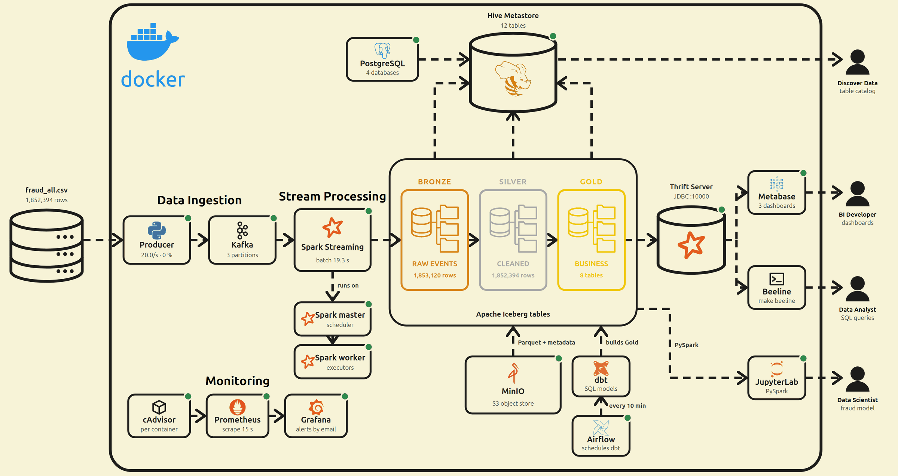
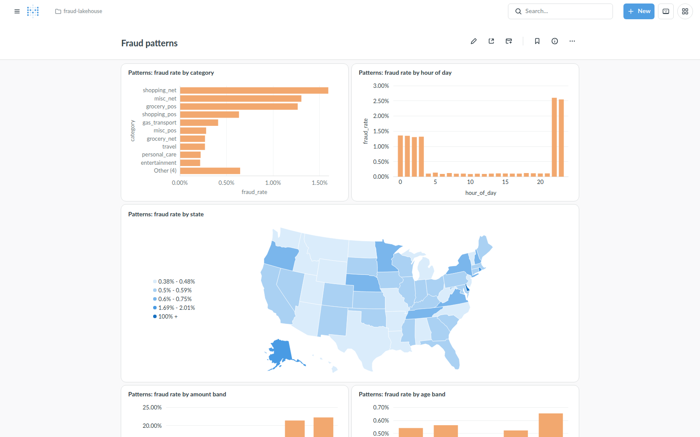
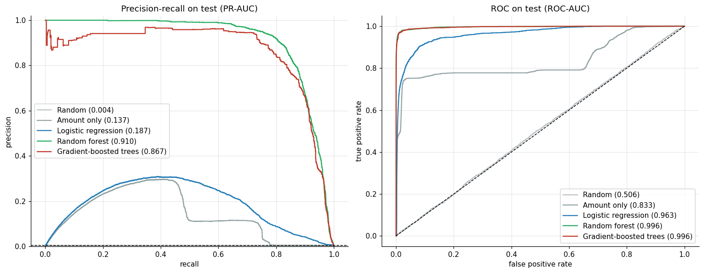
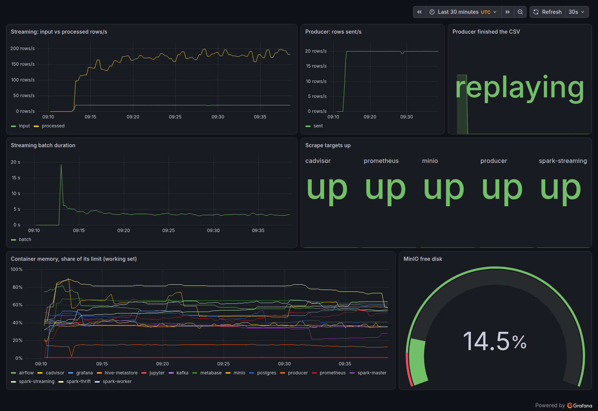
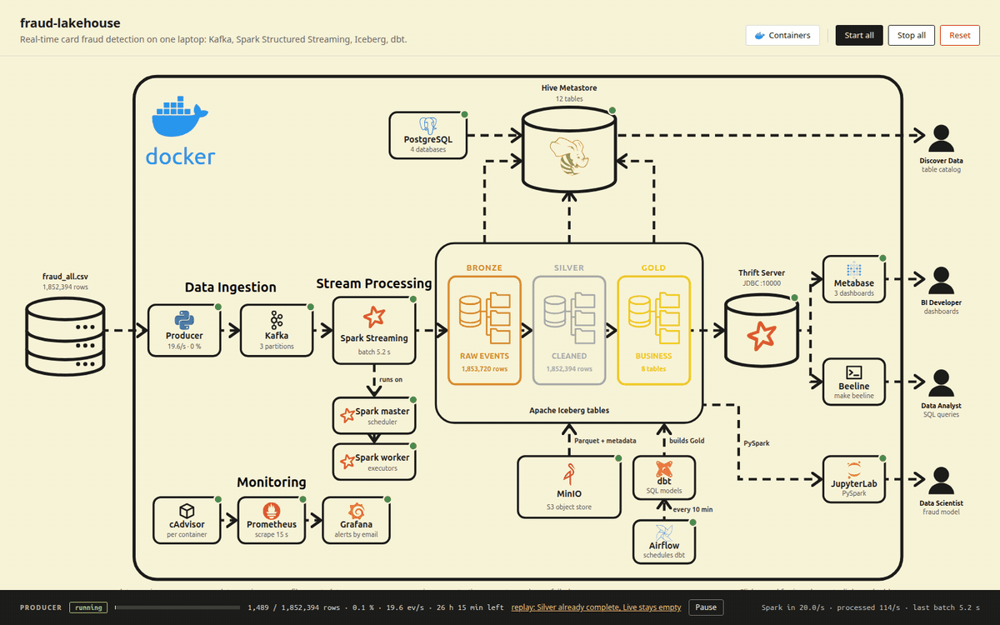

# Architecture

fraud-lakehouse is a real-time card fraud detection lakehouse that runs on one laptop (Ubuntu, 16 GB RAM, 6 cores)
with Docker Compose. A producer replays a Kaggle credit-card dataset into Kafka. Spark Structured Streaming writes
Iceberg tables (Bronze, Silver) on S3-compatible storage. dbt builds Gold tables through the Spark Thrift Server.
Metabase, Beeline and JupyterLab read Silver and Gold. Airflow schedules dbt and table maintenance. Prometheus and
Grafana monitor everything and send email alerts.



Contents: [data flow](#1-data-flow) · [components](#2-components) · [dataset](#3-dataset) · [tables](#4-tables) ·
[orchestration](#5-orchestration) · [serving](#6-serving) · [fraud model](#7-fraud-model) ·
[monitoring](#8-monitoring) · [control center](#9-control-center) · [ports](#10-ports) ·
[memory budget](#memory-budget) · [design decisions](#12-design-decisions) · [out of scope](#13-out-of-scope)

## 1. Data flow

```
data/fraud_all.csv → producer → Kafka topic `transactions`
  → spark-streaming (micro-batch 30 s) → bronze.transactions_raw → silver.transactions (+ silver.transactions_rejected)
  → dbt via spark-thrift, every 10 min (Airflow) → gold.*
  → Metabase (Live dashboard on Silver, others on Gold) · Beeline (SQL) · JupyterLab (PySpark)
Storage: Iceberg tables on MinIO (s3a://lakehouse/warehouse), catalog = Hive Metastore backed by PostgreSQL.
```

`trans_ts` (when the card was used, from the dataset) drives business logic: ages, hours, feature windows, the
train/test split. `event_ts` (when the producer replayed it) drives the Live dashboard.

## 2. Components

| Service | Image | Role |
|---|---|---|
| kafka | `apache/kafka` (KRaft, 1 broker) | topic `transactions`, 3 partitions, 24 h retention, key = `cc_num` |
| producer | built from `producer/` | replays `fraud_all.csv` at `RATE` events/s and resumes from its saved position; at the end of the file it stays idle (exiting would loop under `restart: unless-stopped`) |
| minio | `pgsty/minio` | S3 storage, bucket `lakehouse` (upstream MinIO no longer publishes images) |
| postgres | `postgres` | one instance, 3 databases: `metastore`, `airflow`, `metabase` |
| hive-metastore | `apache/hive` 3.1.3 | Iceberg catalog on port 9083 |
| spark-master / spark-worker | built from `spark/` on `apache/spark` 3.5 | Spark Standalone; worker 6 cores, `SPARK_WORKER_MEMORY=1920m` |
| spark-streaming | same Spark image | long-running job: Kafka → Bronze → Silver in one `foreachBatch` |
| spark-thrift | same Spark image | JDBC SQL endpoint on port 10000, FAIR scheduler |
| airflow | built from `apache/airflow` 3.3, `airflow standalone` | DAGs `gold_refresh` and `lakehouse_maintenance`; dbt-spark in its own venv |
| metabase | `metabase/metabase` (LTS) | dashboards over Silver and Gold, created by code |
| jupyter | Spark image + JupyterLab | fraud model notebook on the same Spark and Python as the cluster |
| prometheus, grafana, cadvisor | `prom/prometheus`, `grafana/grafana`, `gcr.io/cadvisor/cadvisor` | metrics, dashboard, email alerts |

Services are grouped in Compose profiles: the core pipeline has none; `orchestration` (Airflow), `bi` (Metabase),
`notebook` (JupyterLab) and `monitoring` (Prometheus, Grafana, cAdvisor) start on demand.

Spark settings live in `spark/conf/spark-defaults.conf`:
- Every application sets `spark.cores.max=2` (streaming, thrift, jupyter) so none starves the others.
- `spark.executor.memory=640m` (+ 384 MB overhead per executor). Each driver's memory is set per application
  (streaming 512m, thrift 640m, jupyter 512m) so it fits its container limit.
- `spark.sql.session.timeZone=UTC`.
- S3A jars match the Hadoop bundled with Spark 3.5: `hadoop-aws` 3.3.4 and the AWS SDK version it declares.

The Thrift Server starts through `spark-submit --class HiveThriftServer2`, not `start-thriftserver.sh`: that script
leaves a bash process as PID 1 that never forwards SIGTERM, so every stop ended in a SIGKILL after 10 s.

All Python code (shared package, Spark jobs, producer, scripts, notebook) runs on Python 3.10, the version of the
Spark image, so drivers and executors always match. Every image and jar version is pinned in `.env.example`.

## 3. Dataset

Source: Kaggle [`kartik2112/fraud-detection`](https://www.kaggle.com/datasets/kartik2112/fraud-detection),
simulated with Sparkov. `make data` downloads it without a Kaggle account and merges it.

- The zip holds `fraudTrain.csv` (1,296,675 rows, 2019-01-01 → 2020-06-21) and `fraudTest.csv` (555,719 rows,
  2020-06-21 → 2020-12-31).
- `scripts/prepare_data.py` checks the raw header, drops the unnamed index column, sorts `fraudTrain.csv` by
  `trans_date_trans_time` (1,858 rows are out of order), concatenates both files, then checks 22 columns per row,
  time order, unique `trans_num` and 1,852,394 rows. Output: `data/fraud_all.csv` (9,651 frauds, 0.52 %).
- The first `trans_date_trans_time` of `fraudTest.csv` is `TEST_SPLIT_TS` in `src/fraud_lakehouse/schemas.py`.
- `make data` is idempotent: it skips the download if the zip exists and the merge if the output is valid.

Columns: `trans_date_trans_time, cc_num, merchant, category, amt, first, last, gender, street, city, state, zip,
lat, long, city_pop, job, dob, trans_num, unix_time, merch_lat, merch_long, is_fraud`.

Quirks handled in Silver:
- `unix_time` is shifted by 7 years, so it is ignored.
- Every `merchant` starts with `fraud_` (a simulator artifact, not a label), so the prefix is stripped.
- `zip` loses its leading zeros in the CSV, so it is stored as a 5-character string.
- `is_fraud` is the model target, never a feature.

## 4. Tables

### bronze.transactions_raw: append only, partitioned by `days(ingest_ts)`

`value STRING` (raw JSON), `kafka_topic`, `kafka_partition INT`, `kafka_offset BIGINT`, `kafka_ts TIMESTAMP`,
`ingest_ts TIMESTAMP`.

### silver.transactions: one row per `trans_num`, partitioned by `months(trans_ts)`

Transformations, in order:
1. parse the JSON with a fixed schema, cast types, validate;
2. clean: strip `fraud_`, `card_hash = sha2(concat(HASH_SALT, cc_num), 256)`, drop `cc_num, first, last, street,
   dob, unix_time`;
3. enrich: `age` in full years at `trans_ts`, haversine `distance_km`, `hour_of_day`, `day_of_week` (1 = Sunday);
4. deduplicate on `trans_num` within the batch (`MERGE` fails if two source rows match one target row);
5. `MERGE` on `trans_num`, insert only.

`write.merge.mode=merge-on-read`; nightly compaction rewrites the delete files. Silver is written ordered by
`event_ts`, so the Live dashboard's last-hour query skips older files by their min/max (measured: 3 of 32 data
files read, about 0.2 s).

Columns: `trans_num, trans_ts, event_ts, card_hash, merchant, category, amt, gender, city, state, zip, lat, long,
merch_lat, merch_long, city_pop, job, age, distance_km, hour_of_day, day_of_week, is_fraud, ingest_ts`.

Validation rules, checked in this order; the first failure becomes the `reason` in
`silver.transactions_rejected(raw_value, reason, ingest_ts)`:

| Rule | Reason |
|---|---|
| JSON parses | `malformed_json` |
| `trans_num` not null | `trans_num_null` |
| `trans_ts` valid | `trans_ts_invalid` |
| `amt > 0` | `amt_not_positive` |
| `category` is one of the 14 known values | `category_unknown` |
| latitudes in [-90, 90], longitudes in [-180, 180] | `coordinates_out_of_range` |
| `is_fraud` in (0, 1) | `is_fraud_invalid` |

### gold.*: built by dbt from `stg_transactions` (a view over Silver)

Shared fraud metrics (macro `fraud_metrics`): `tx_count`, `fraud_count`, `fraud_rate` (0–1), `fraud_amt`.

| Model | Grain | Extra columns |
|---|---|---|
| `fraud_by_category` | category | |
| `fraud_by_hour_of_day` | `hour_of_day` 0–23 | |
| `fraud_by_state` | state | mean `lat`, `long` for the map |
| `fraud_by_amount_band` | <10, 10–50, 50–100, 100–500, 500–1000, >1000 $ | `band_order` |
| `fraud_by_age_band` | <18, 18–25, 26–40, 41–60, >60 | `band_order` |
| `merchant_risk` | merchant, at least 100 transactions | `risk_rank` |
| `customer_risk_profile` | card_hash | `total_amt`, `first_ts`, `last_ts` |
| `ml_features` | transaction | see below; tag `ml`, built on demand |

`ml_features` columns: `trans_num, trans_ts, card_hash, category, gender, age, amt, log_amt, hour_of_day,
day_of_week, is_night` (22:00–05:59), `distance_km, log_city_pop, card_tx_count_1h, card_tx_count_24h,
card_amt_ratio` (`amt` / the card's mean over the previous 24 h), `secs_since_last_tx, is_fraud, split`
(`train` before `TEST_SPLIT_TS`, else `test`). Card features use windows over the past only
(`range between N preceding and 1 preceding`), so no feature sees the transaction it describes or anything after.

Every Gold model has `not_null` and `unique` tests in `schema.yml`. `dbt source freshness` warns when Silver has
had no new row for 5 min.

## 5. Orchestration

| DAG | Schedule | Tasks |
|---|---|---|
| `gold_refresh` | every 10 min | `dbt source freshness` (warn only) → `dbt run --exclude tag:ml` → `dbt test --exclude tag:ml` |
| `lakehouse_maintenance` | daily 03:00 | per schema: `rewrite_data_files` → `rewrite_manifests` → `expire_snapshots` (> 3 days) → `remove_orphan_files` |

Both DAGs only send SQL to spark-thrift; Airflow has no Spark install. Failures email `ALERT_EMAIL`.
Compaction can conflict with a streaming `MERGE` commit. Either side may lose: the streaming batch fails and the
service replays it from its checkpoint, or a maintenance task retries (twice, after 1 min). The Iceberg
procedures are safe to rerun, so the conflict costs time, never data.

Measured durations: `gold_refresh` 26–28 s on a quiet stack, 60 s while maintenance and `ml_features` run.
`lakehouse_maintenance` 67 s on a quiet stack, about 4 min under load.

## 6. Serving

### Metabase

Three dashboards, all on the Spark Thrift Server:

1. **Live** (refresh 1 min, Silver, last hour by `event_ts`): transactions, frauds, fraud rate and amount;
   a per-minute line; the latest frauds.
2. **Fraud patterns** (refresh 10 min, Gold): fraud rate by category, hour, state (map), amount band, age band.
3. **Risk** (refresh 10 min, Gold): riskiest merchants, riskiest cards, cards hit.



The dashboards are code. `src/fraud_lakehouse/dashboards.py` declares each card (SQL, chart type, grid position);
`make metabase-setup` creates or updates them through the Metabase REST API, found by name, so it is safe to
rerun. Metabase open source cannot export dashboards to files, and a dump of its database is tied to one version.
Changes made in the UI are overwritten on the next run.

Two connections, `Lakehouse silver` and `Lakehouse gold`: the Spark SQL driver only syncs the tables of its
connection's database. Neither scans column values, so Metabase never sends a `SELECT DISTINCT` over Silver.

No alert on the hourly fraud rate: over the full dataset cut into one-hour replay windows, the rate ranges from
0.29 % to 0.96 % (median 0.50 %, p95 0.84 %), so no threshold separates an anomaly from noise.

### Beeline and JupyterLab

`make beeline` opens a SQL shell on the Thrift Server. JupyterLab (profile `notebook`) runs PySpark drivers on the
cluster; the fraud model notebook is described next.

## 7. Fraud model

`notebooks/fraud_model.ipynb` compares five models on `gold.ml_features`, trained on the cluster with Spark MLlib.
It is committed with its outputs, so its tables and charts are readable on GitHub; the charts are also saved in
`notebooks/figures/`.

- **Split, in time order.** Fit on the first 80 % of `train`, choose each model's threshold on the last 20 %,
  report on `test` (the fraudTest.csv period), touched once. A random split would let the model learn from the
  future.
- **Models.** A random score and an amount-only rule as baselines; logistic regression, random forest and
  gradient-boosted trees with the same features and class weights (each class carries half the training weight).
- **Metrics.** PR-AUC (average precision) ranks the models: frauds are 0.4 % of the test rows, so accuracy is
  meaningless and ROC-AUC flatters every model. Precision, recall and F1 are read at the threshold with the best F1
  on validation. The notebook also reports alerts per day and the share of the fraud amount caught.
- **Code.** Feature preparation, class weights and the time split are in `src/fraud_lakehouse/model.py`; metrics on
  (label, score) arrays are in `src/fraud_lakehouse/metrics.py`. Both are unit-tested. Seed 42.



The notebook needs the test period in Gold: the replay must pass 2020-06-21 (`RATE=500` replays the CSV in about
1 h), then `make ml-features`. Before that, it stops on load and says so. `make notebook-run` runs it headless.

## 8. Monitoring

Prometheus scrapes every 15 s:
- **cAdvisor:** memory and CPU per container, filtered on the Compose project label.
- **spark-streaming:** Spark's `/metrics/prometheus` on the driver UI. `spark.metrics.namespace=${spark.app.name}`
  keeps metric names stable across restarts.
- **producer:** `producer_rows_sent_total`, `producer_position` and `producer_finished`, port 8000.
- **MinIO:** `/minio/v2/metrics/cluster`.

Spark does not commit offsets to Kafka, so lag is read from Spark itself: processed rate against input rate.

Grafana provisions everything from `monitoring/grafana/`: the data source, the Pipeline dashboard and six email
alerts (evaluated every 30 s, repeated every 4 h while they last).



| Alert | Fires when | For |
|---|---|---|
| Target down | a scrape target does not answer | 1 min |
| Streaming falls behind | processed rows/s < input rows/s | 5 min |
| Streaming batch over 30 s | batch duration > the 30 s trigger | 5 min |
| No streaming input | input rate = 0 **and** the producer has not reported `producer_finished = 1` | 4 min |
| Container memory over 90 % of its limit | working set / limit (not usage, which counts page cache) | 5 min |
| MinIO free disk under 10 % | usable free / usable total | 5 min |

"No streaming input" is gated by `producer_finished`: after a complete replay the input rate is 0 for good, and a
plain "rate = 0" rule would ring forever. Measured with `docker compose stop producer`: Target down emailed after
1 min 28 s, No streaming input after 5 min 25 s.

Email goes through SMTP settings in `.env` (`SMTP_HOST`, `SMTP_PORT`, `SMTP_USER`, `SMTP_PASSWORD`,
`ALERT_EMAIL`), used by Grafana for infrastructure and by Airflow for DAG failures.

## 9. Control center

`make control-center` serves a page on http://localhost:8099. It draws the pipeline with each service's live state
and lets you run the stack without a terminal.



- **Start all** runs `make up-all`, **Stop all** runs `make down`, **Reset** deletes every volume (you type
  `reset` to confirm). One action runs at a time; the page shows its output.
- Each card opens a panel: role, ports, image, memory, links (MinIO folders, Spark UIs, Airflow, each Metabase
  dashboard, Grafana, JupyterLab). The Hive Metastore panel lists every table with rows, size and last write.
- Services that ingestion never waits on (producer, Airflow, Metabase, JupyterLab, Prometheus, Grafana, cAdvisor)
  can be stopped and started on their own; the producer can be paused.
- The bottom bar shows the producer's position in the CSV, its rate, the time left, and Spark's input and
  processing rates. These come from the producer's and Spark's own endpoints, so they work without monitoring.

The server (`scripts/control_center.py`, standard library only) runs on the host, bound to 127.0.0.1, with the user's
own `docker` and `make`. In a container it would need the Docker socket, which is root on the machine. Each button
maps to a fixed command in `src/fraud_lakehouse/control_center.py`; anything else is refused. POST requests need a custom
header and a `localhost` Host header, which blocks cross-site requests and DNS rebinding.

## 10. Ports

| Service | Host port |
|---|---|
| Control center | 8099 (127.0.0.1) |
| Kafka (external listener) | 9094 |
| MinIO API / console | 9000 / 9001 |
| Spark master UI / worker UI | 8080 / 8081 |
| spark-streaming UI / spark-thrift UI | 4040 / 4041 |
| spark-thrift JDBC | 10000 |
| Airflow | 8082 |
| Metabase | 3000 |
| Grafana | 3001 |
| Prometheus | 9090 |
| JupyterLab | 8888 |
| Producer metrics | 8000 (127.0.0.1) |

## 11. Resources

### Memory budget

Every long-running service has a memory limit, set from measurements:

| Profile | Services and limits | Total |
|---|---|---|
| core | spark-worker 3.5 G · spark-thrift 1.25 G · spark-streaming 1.25 G · kafka 768 M · hive-metastore 640 M · minio 512 M · spark-master 512 M · postgres 384 M · producer 128 M | ≈ 8.9 GB |
| orchestration | airflow 2 G | 2 GB |
| bi | metabase 1.5 G | 1.5 GB |
| notebook | jupyter 1.5 G | 1.5 GB |
| monitoring | grafana 768 M · prometheus 256 M · cadvisor 96 M | 1.1 GB |

`make up-all` (every profile but `notebook`) reserves about 13.5 GB. Day-to-day work runs core plus one profile.
The spark-worker hosts three executors (streaming, thrift, jupyter), each 640 MB + 384 MB overhead.

### What the limits are based on

- **JVM drivers need more than their heap.** spark-streaming (512m heap) settles at 960–998 MiB of RSS after 8 h
  (179 MB metaspace, 356 threads): flat, not a leak, hence 1.25 G. glibc gave each thread its own malloc arena,
  266 MB outside the JVM's memory; `MALLOC_ARENA_MAX=2` brought that to 53 MB and is set on every Spark driver.
- **spark-thrift under dbt load** reached 1044 MB of RSS for a 640m heap; 1 G was hit 664 times in 23 min, so its
  limit is 1.25 G.
- **Metabase** with a 512m heap needs about 1.05 GB (metaspace and compiled code); 1 G was hit thousands of times
  in 10 min, 1.5 G settles at 1054 MiB.
- **JupyterLab** training on 1 M rows peaked at 1205 MiB (driver, kernel and JupyterLab), 74 % of its 1.5 G.
- **Grafana** holds about 240 MiB of process plus 200 MiB of its own files in active page cache after a restart;
  at 512m that read as 90 % and fired its own memory alert, so it has 768m.
- **Recovery:** `make recovery-check` (`docker compose down`, then `up`) had every service healthy 136 s later,
  with no Silver row lost, no Kafka offset gap and no duplicate.

## 12. Design decisions

**Iceberg on MinIO, catalog in Hive Metastore 3.1.3.** Iceberg gives atomic commits on object storage, `MERGE` for
deduplication, compaction and time travel. The catalog is a Hive Metastore so streaming, the Thrift Server and
Jupyter share it and Metabase sees tables without a catalog prefix. It is pinned to 3.1.3: Hive 4 removed the
`get_table` call that Spark 3.5's built-in Hive client uses. The metastore only stores metadata; Spark does all data
I/O. A one-shot `hive-schema-init` service creates the schema only when none exists, because the image's own
`-initSchema` is not re-runnable.

**Spark master recovery on a volume.** Without it, a restarted master forgets running applications and their
drivers wait forever while their healthchecks stay green. `spark.deploy.recoveryMode=FILESYSTEM` on a named volume
fixes that without a ZooKeeper service for a single master.

**Producer: saved position, at least once.** Kafka does not track a producer's progress, so the producer saves the
number of rows already sent, atomically (temp file and rename), once per second and only after Kafka acknowledged
every earlier event. On SIGTERM it flushes and saves. After a failed delivery it exits without saving. A crash
resends at most about a second of events; Silver's `MERGE` removes them. Kafka transactions were not used: they
need a transactional id, fencing and `read_committed` consumers for a single-writer replay.

**Streaming: one `foreachBatch` for Bronze and Silver.** Each 30 s batch appends to Bronze and to the rejected
table, then merges into Silver on `trans_num`. Insert-only: a replayed event equals the stored one, so the merge
writes no delete files. Two queries (Kafka → Bronze, Bronze → Silver) would double the checkpoints and the latency.
The checkpoint is on a local volume because S3A renames are not atomic. If a batch fails after its appends, the
replay appends again: Bronze and the rejected table may hold duplicates, Silver stays unique.

**Airflow standalone, dbt in its own venv.** One container runs the scheduler, DAG processor, triggerer and API
server with LocalExecutor, enough for one laptop and not for production. dbt-spark lives in `/opt/dbt-venv`, so its
dependencies never meet Airflow's. Maintenance is a dbt macro that calls the Iceberg procedures, so Airflow needs no
Spark or Hive client. Airflow is pinned to 3.3, the last line on Python 3.10.

**Metabase dashboards as code** through the REST API (see [Serving](#metabase)).

**Model metrics in numpy, threshold on validation.** Spark's evaluator reads only a probability vector, so it cannot
score the rule baselines. Metrics on (label, score) arrays work for any score, give the curves, and pick an exact
best-F1 threshold at a fraud's score. Training stays on the cluster; only the scores come back to the driver.

**Control center on the host, not in a container** (see [Control center](#9-control-center)).

**Left out on purpose:** MLflow, a Schema Registry, Kafka Connect, Alertmanager, Celery, a Kafka exporter. None is
needed at this scale, and each would cost memory the budget does not have.

## 13. Out of scope

Multi-node deployment, per-user access control (Apache Ranger), real-time model scoring in the stream, cloud
deployment.
